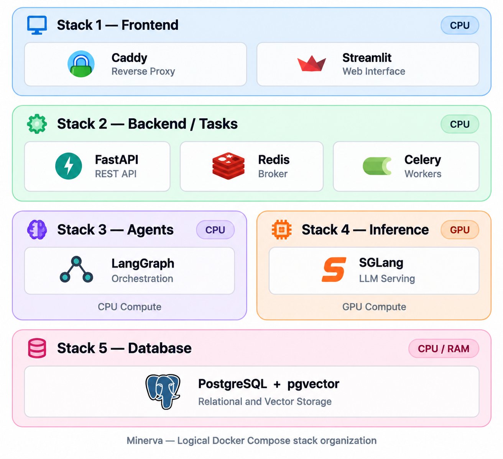
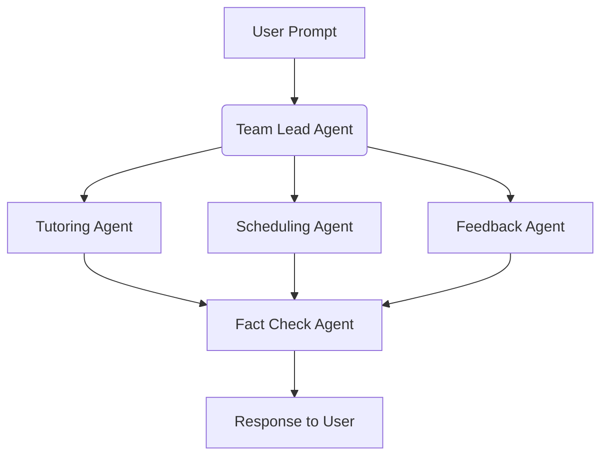

# ENGR-E516_Minerva
An AI academic tutor designed to help graduate students manage resources, get instant tutoring access, and receive immediate assignment and project feedback.

## Basic Software Architecture
Minerva uses an Model View Controller (MVC) architecture for multi-node cloud computing. The basic architecture is designed as follows:

### Logical Application Split Using Docker Compose Stacks

To keep logical groups of services in Minerva separate and to allow for proper vertical scaling, services will be deployed in docker compose stacks. These stacks also enable reproducibility and transportability between compute instances.

Compose stacks also allow for easy initial testing on a single VM, while allowing for easy decoupling and scaling out to multiple VMs. 

Following is an outline of what each stack will contain:

*Note: At this time, proper horizontal scaling (dynamically spinning up new VMs) is not in scope. Were that a requirement different services would need to scale differently.*

## Initial Agent Flow

The general flow to get an LLM response to a user is defined as follows:

